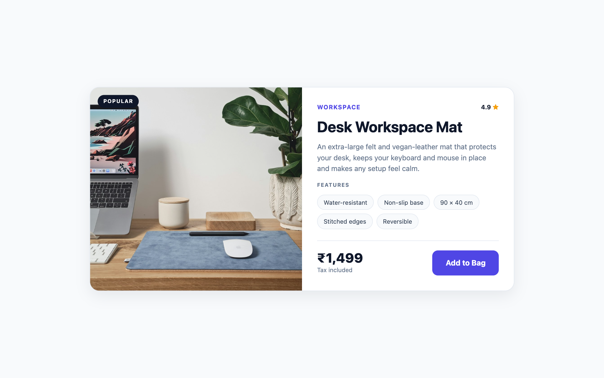
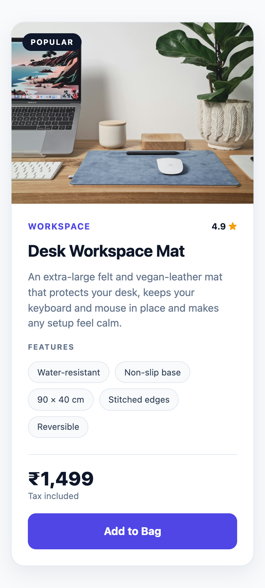
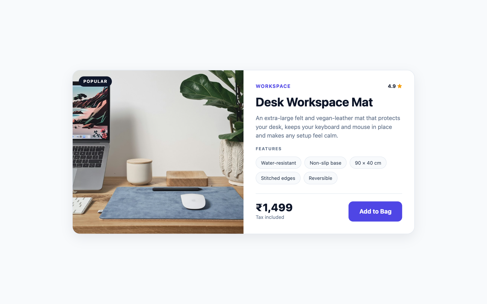

# Task 1 — Product Showcase Card

A product card that is a **single-column stack on mobile** and a
**two-column grid on desktop (≥ 768px)**.

Open [`index.html`](index.html) in a browser and resize the window (or use
DevTools → Device Toolbar) to see the layout switch.

## How the requirements are met

| Requirement | Implementation (`style.css`) |
|-------------|------------------------------|
| Mobile-first, full-width button | Base `.product-card { grid-template-columns: 1fr }`, `.btn-add { width: 100% }` |
| Desktop 2-column grid | `@media (min-width: 768px) { .product-card { grid-template-columns: 1fr 1fr } }` |
| Details distributed vertically | `.product-details { display:flex; flex-direction:column; justify-content:space-between }` |
| Category/rating row & price shelf | `.meta-row`, `.purchase-shelf { display:flex; justify-content:space-between }` |
| Image zoom on hover | `transition: transform 0.3s ease` → `transform: scale(1.04)` |
| Button press | `.btn-add:active { transform: scale(0.96) }` |

Extras: wrapping feature tags (`flex-wrap`), `:focus-visible` outline and a
`prefers-reduced-motion` override.

## Screenshots

| Desktop | Mobile (390px) |
|---------|----------------|
|  |  |

Interaction state — image zoom on hover:

## Image credit

Product photo by [Workperch](https://unsplash.com/@workperch) on
[Unsplash](https://unsplash.com/photos/m-jcgSZlLS0), used under the
[Unsplash License](https://unsplash.com/license).
