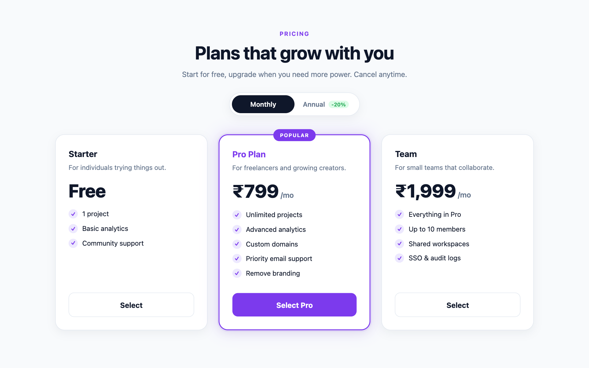
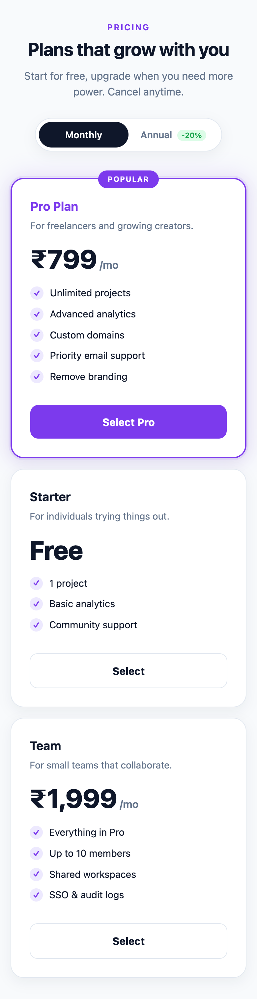
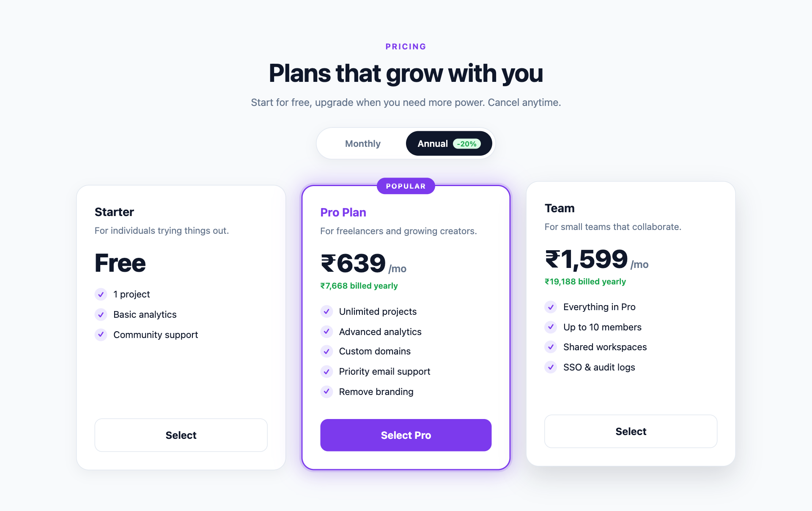

# Task 2 — Responsive Pricing Cards

A three-tier pricing section with a **Monthly / Annual billing toggle**.
Cards **stack on mobile** and sit **side-by-side from 850px**.

Open [`index.html`](index.html) in a browser and resize the window.
Click *Annual* to see discounted prices — the toggle is built with
**pure CSS** (hidden radio inputs + `:checked ~` selectors), no JavaScript.

## How the requirements are met

| Requirement | Implementation (`style.css`) |
|-------------|------------------------------|
| Grid, 1 column on mobile | `.pricing-grid { display:grid; grid-template-columns:1fr }` |
| 3 columns on desktop | `@media (min-width: 850px) { grid-template-columns: repeat(3, 1fr); gap: 1.5rem }` |
| Toggle pill | `.billing-toggle { display:inline-flex; align-items:center }` |
| Button flush at bottom | `.price-card { display:flex; flex-direction:column; justify-content:space-between }` |
| Hover lift | `transform: translateY(-6px)` with `transition: transform 0.25s ease, box-shadow 0.25s ease` |
| Pro card glow | `@keyframes glow-pulse` animating the opacity of a glowing `::after` layer |

Extras: Pro card is listed first on mobile (`order: -1`), sliding toggle thumb
(`translateX`), keyboard focus styles and `prefers-reduced-motion` support.

## Screenshots

| Desktop | Mobile (390px) |
|---------|----------------|
|  |  |

Interaction state — annual billing selected + card hover lift:

