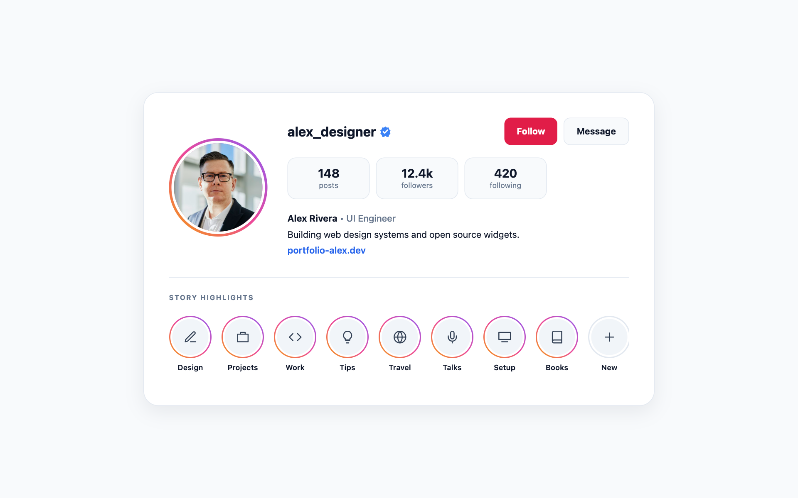
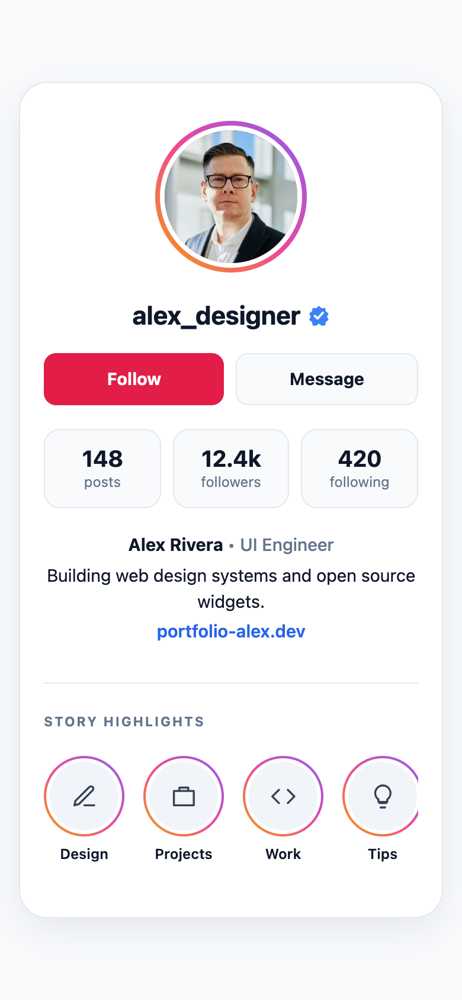
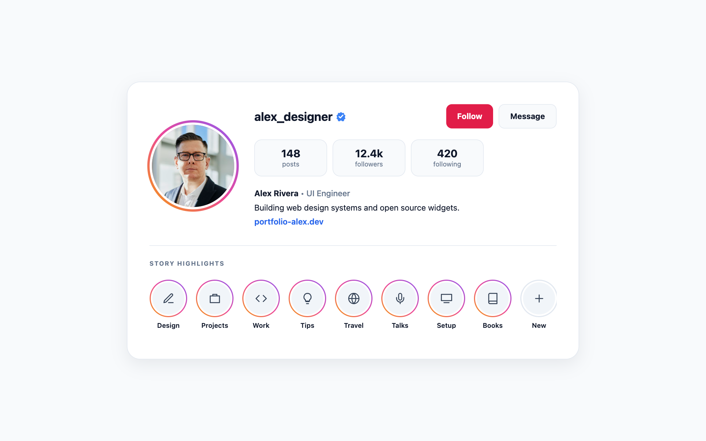

# Task 4 — Creator Profile Header & Stats Card

A social creator profile header. On **mobile** everything is **centred in a
vertical stack**; from **768px** the avatar sits **left** and details
**right**.

Open [`index.html`](index.html) in a browser and resize the window. Scroll the
*Story Highlights* strip sideways.

## How the requirements are met

| Requirement | Implementation (`style.css`) |
|-------------|------------------------------|
| Centred mobile stack | `.profile-header { display:flex; flex-direction:column; align-items:center }` |
| Equal-width Follow / Message | `.profile-actions { display:flex }`, `.btn { flex:1 }` |
| Desktop row | `@media (min-width: 768px) { .profile-header { flex-direction: row } }` |
| Stats bar | `.stats { display:grid; grid-template-columns: repeat(3, 1fr) }` |
| Story highlights | `.highlight-strip { display:flex; overflow-x:auto; gap:1rem }`, `.highlight { flex-shrink:0 }` |
| Avatar hover | `transform: scale(1.05)` with `transition: transform 0.25s ease` |
| Follow press | `.btn:active { transform: scale(0.95) }` |

Extras: gradient story rings, verified badge, `scroll-snap` on the highlights
strip, focus-visible outlines and `prefers-reduced-motion` support.

## Screenshots

| Desktop | Mobile (390px) |
|---------|----------------|
|  |  |

Interaction state — avatar scale on hover:

## Image credit

Avatar photo by [LinkedIn Sales Solutions](https://unsplash.com/@linkedinsalesnavigator)
on [Unsplash](https://unsplash.com/photos/pAtA8xe_iVM), used under the
[Unsplash License](https://unsplash.com/license). "Alex Rivera" is a fictional
profile created for this exercise.
